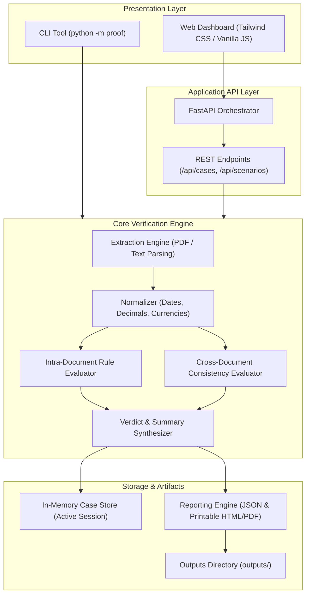
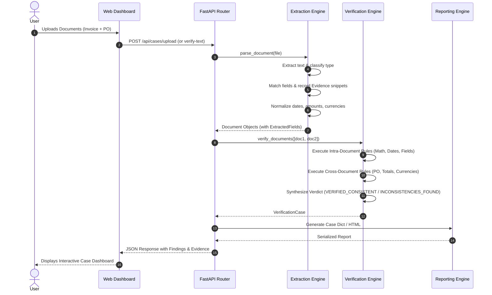
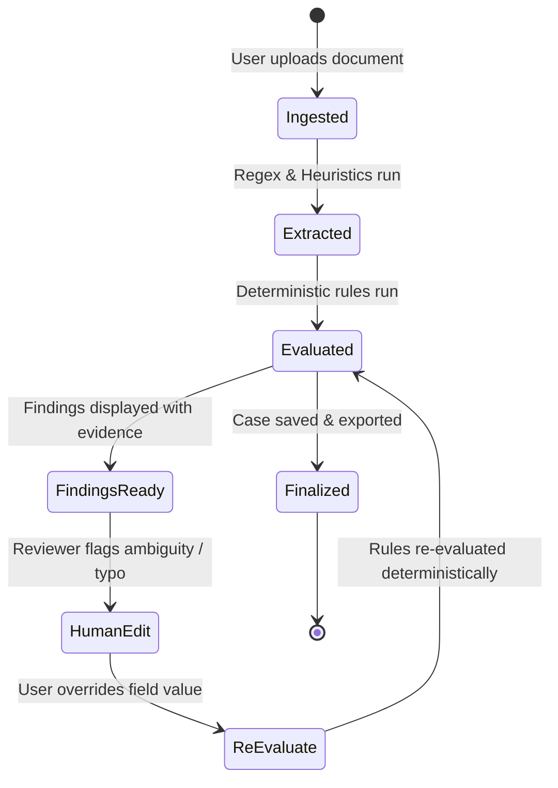

# PROOF — System Architecture (ARCHITECTURE.md)

**System:** PROOF (Document Intelligence & Consistency Verification)  
**Architecture Style:** Modular Monolith  
**Version:** 0.1.0  

---

## 1. High-Level System Architecture

PROOF is architected as an evidence-first, deterministic **modular monolith**. Presentation, extraction, verification, and reporting operate as decoupled Python modules communicating via typed Pydantic models.

---

## 2. Component Breakdown

### 2.1 Presentation Layer
- **Interactive Web Dashboard (`proof/static/index.html`):**
  - Instant 1-click loading of benchmark procurement scenarios.
  - Multi-file drag-and-drop zone and raw text paste interface.
  - Dynamic verdict banner and status statistics breakdown.
  - Side-by-side extracted fields inspector with verbatim source citations.
  - Human-in-the-loop modal allowing reviewers to edit extracted fields and trigger instantaneous deterministic re-evaluations.
- **Command Line Interface (`proof/__main__.py`):**
  - Single-document and multi-document batch verification.
  - Formatted terminal report with verbatim source evidence quotes.
  - `--serve` command to launch the web platform.
  - `--demo` command to execute the built-in benchmark test cases.

### 2.2 Application API Layer (`proof/app.py`)
- Provides RESTful endpoints for case creation, document uploading, benchmark loading, and human-in-the-loop review overrides.
- Implements CORS middleware and static asset serving for seamless single-command deployment.

### 2.3 Extraction & Normalization Engine (`proof/extract.py`)
- **Document Ingestion:** Reads structured text or extracts text from multi-page PDFs using `pypdf`.
- **Classification:** Automatically identifies whether a document represents an `Invoice`, `Purchase Order`, `Receipt`, `Contract`, or `Unknown`.
- **Field Matching & Citation:** Employs regex patterns and contextual aliases to extract key-value pairs while recording verbatim snippet line numbers and page numbers as immutable `Evidence` objects.
- **Normalization:**
  - Converts diverse date formats (`YYYY-MM-DD`, `DD/MM/YYYY`, `Month DD, YYYY`) to ISO 8601 (`YYYY-MM-DD`).
  - Converts monetary amounts to standard 2-decimal place `Decimal` values, handling thousand separators and European decimals.
  - Standardizes currency representations (`$`, `₹`, `€`, `USD`, `INR`) to 3-letter ISO codes.

### 2.4 Deterministic Verification Engine (`proof/rules.py` & `proof/engine.py`)
- Executes independent, reproducible validation rules without relying on generative LLMs for numerical comparisons.
- **Intra-Document Logic:** Required fields, date sequence sanity, and tax/total arithmetic ($\text{Subtotal} + \text{Tax} = \text{Total}$).
- **Cross-Document Consistency:** PO reference correspondence, cross-document monetary matching with variance delta calculation, currency matching, chronological ordering between procurement order and invoice, and counterparty correspondence.
- Every check resolves to one of the six standardized categories: `Match`, `Mismatch`, `Missing`, `Unable to verify`, `Needs review`, or `Not applicable`.

### 2.5 Reporting Engine (`proof/report.py`)
- Generates structured, machine-readable JSON reports containing complete audit metadata.
- Generates standalone, printable HTML audit reports formatted with executive summaries, visual status indicators, and evidence citations.

---

## 3. Data Flow & Verification Pipeline

---

## 4. Human-In-The-Loop Review Architecture

When a human reviewer modifies a field in the UI:
1. The original source snippet and extraction method remain preserved.
2. The field is tagged with `is_reviewed = True` and `user_override = <value>`.
3. The verification pipeline re-evaluates all intra- and cross-document rules against the modified state.
4. The audit trail records both the initial extraction and the reviewer's modification.
